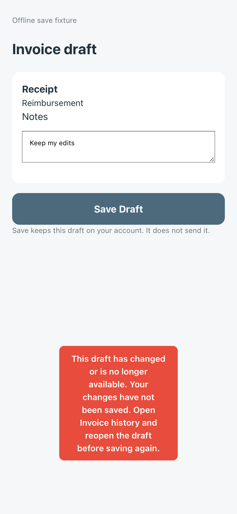

# FU17 undated draft save

The Trade App already sends each returned `draft_id` on the next undated
`save_trade_invoice_draft` request. The new regression check drives that real
page function through three saves and verifies that the receipt stays present.

Stale and office-changed drafts now say that saving failed and direct the trade
to reopen the draft from Invoice history. A failed selected-draft read asks the
trade to retry. Both keep entered lines and the selected identity, and neither
enters the generic offline retry path.

Run from the repository root:

```sh
deno test --no-check --allow-env --allow-read tests/unit/trade-undated-draft_test.ts
```

Result: 6 passed, 0 failed. Main's save function passes the identity and legacy
behavior cases but fails the two new refusal-message cases: 4 passed, 2 failed.
For this comparison only, the test extraction input appends an unused empty
message helper, since main has no such function. Main's save body is unchanged.



17 Nov: self-checked in headless WebKit at 390 by 844, under the browser lock.
The offline screen harness uses the shipped save function, toast renderer and
page CSS with a refused API fixture. A Save Draft tap displays the complete
message within the phone viewport and leaves the notes unchanged. This proves
the message rendering and refusal handler, not a signed-in or live save.

No switch was changed, no migration added, no live request made and no Xero
payload changed. The reimbursements switch remains off pending director proof.
